<!-- AYOMIPOSI AKINWUMI | GITHUB PROFILE -->

<div align="center">

<!-- ANIMATED NAME AND SKILLS HEADER -->


<!-- ORIGINAL THREE ANIMATED MESSAGES -->


<!-- PROFILE VIEWS -->
<p>
  
</p>

<p>
  <strong>I turn complex ideas into simple, functional products.</strong>
</p>

<p>
  I work on mobile apps, backend systems, and UI/UX design.
  I enjoy building products that solve real problems and are easy to use.
</p>


</div>

<!-- SKILLS & TOOLS -->
<details open>
<summary><strong>Skills & Tools</strong></summary>

<div align="center">

<h4>Languages & Frameworks</h4>


<h4>Development & Design Tools</h4>


</div>

</details>

<!-- GITHUB STATISTICS -->
<details open>
<summary><strong>GitHub Statistics</strong></summary>

<div align="center">

<!-- GITHUB STREAK FIRST -->
<a href="https://github.com/ayjed">
  
</a>

<!-- TWO PROFESSIONALLY ALIGNED STATISTICS CARDS -->
<table align="center">
<tr>
<td align="center" valign="top" width="50%">

<!-- GITHUB STATS & GRADE -->
<a href="https://github.com/ayjed">
  
</a>

</td>
<td align="center" valign="top" width="50%">

<!-- MOST USED LANGUAGES -->
<a href="https://github.com/ayjed?tab=repositories">
  
</a>

</td>
</tr>
</table>

</div>

</details>

<!-- CONTRIBUTION ACTIVITY -->
<details open>
<summary><strong>Contribution Activity</strong></summary>

<div align="center">

<!-- PAC-MAN CONTRIBUTION ANIMATION -->
<picture>
  <source
    media="(prefers-color-scheme: dark)"
    srcset="https://raw.githubusercontent.com/ayjed/ayjed/output/pacman-contribution-graph-dark.svg"
  />
  <source
    media="(prefers-color-scheme: light)"
    srcset="https://raw.githubusercontent.com/ayjed/ayjed/output/pacman-contribution-graph.svg"
  />
  
</picture>

<!-- GITHUB CONTRIBUTION GRAPH BELOW PAC-MAN -->
<a href="https://github.com/ayjed">
  
</a>

</div>

</details>

<!-- DEVELOPER QUOTES -->
<details open>
<summary><strong>Developer Quotes</strong></summary>

<div align="center">


</div>

</details>

<!-- WHAT I'M CURRENTLY WORKING ON -->
<details open>
<summary><strong>What I'm Currently Working On</strong></summary>

```javascript
const currentFocus = {
  mobile: "Building Flutter applications",
  backend: "Developing APIs and reliable systems",
  design: "Creating intuitive UI/UX experiences",
  web: "Improving Motekra's digital presence",
  projects: ["MOTEKRA", "PICKY-X"],
  approach: "Build. Test. Improve. Ship."
};
```

</details>

<!-- CONTACT ME -->
<details open>
<summary><strong>Contact Me</strong></summary>

<div align="center">

<!-- ORIGINAL CONTACT ICONS AND LINKS -->
<p align="center">
<a href="https://github.com/ayjed" title="GitHub"></a>
<a href="https://www.motekra.com" title="Motekra Portfolio"></a>
<a href="https://www.linkedin.com/in/akinwumi-ayomiposi/" title="LinkedIn"></a>
<a href="https://wa.me/2347067664476" title="WhatsApp"></a>
<a href="mailto:akinwumiayomiposi76@gmail.com" title="Email"></a>
</p>

<sub>Open to collaborations, exciting projects, and new opportunities.</sub>

<!-- APPROVED 105PX FOOTER WAVE -->


</div>

</details>
